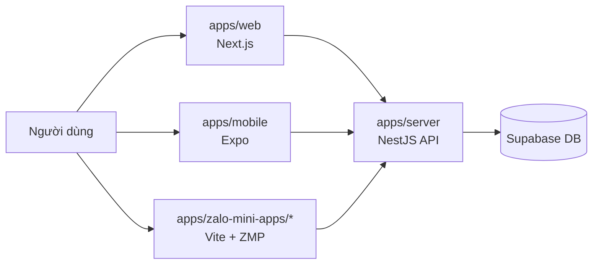

# Kiến Trúc Hệ Thống - Mục Lục Trung Tâm

## 1) Mục tiêu tài liệu
- Là bộ tài liệu kiến trúc/kỹ thuật chuẩn cho toàn bộ monorepo hiện tại.
- Phản ánh đúng trạng thái source đang chạy, không dựa vào cấu trúc cũ (`Next-cli`, `Vite-cli`).
- Là điểm vào cho dev mới, QA, PM, DevOps khi cần hiểu hệ thống end-to-end.

## 2) Trạng thái hệ thống tại thời điểm cập nhật
- Monorepo hiện có các app runtime chính:
  - `apps/web` (Next.js 16 + React 19): web UI + compatibility API adapters tạm thời.
  - `apps/mobile` (Expo 53 + React Native 0.79): mobile companion.
  - `apps/zalo-mini-apps/*` (4 mini apps Vite + React 18): kênh Zalo.
  - `apps/server` (NestJS 11): API source-of-truth và là DB gateway duy nhất.
- Backend dữ liệu vận hành trên Supabase (Postgres/Auth/RLS/Storage/Realtime), với quyền truy cập DB chỉ ở `apps/server`.
- `apps/web/src/app/api/**` chỉ giữ vai trò compatibility trong giai đoạn migration.

## 3) Bản đồ tài liệu (thứ tự đọc khuyến nghị)
1. [001_system_landscape.md](./001_system_landscape.md)
2. [002_repo_structure_and_engineering_contracts.md](./002_repo_structure_and_engineering_contracts.md)
3. [003_web_app_architecture.md](./003_web_app_architecture.md)
4. [004_data_platform_supabase_and_sql.md](./004_data_platform_supabase_and_sql.md)
5. [005_auth_rbac_feature_flags_and_security.md](./005_auth_rbac_feature_flags_and_security.md)
6. [006_client_state_offline_realtime_voice.md](./006_client_state_offline_realtime_voice.md)
7. [007_mobile_and_zalo_mini_apps.md](./007_mobile_and_zalo_mini_apps.md)
8. [008_nest_server_target_and_migration.md](./008_nest_server_target_and_migration.md)
9. [009_delivery_observability_and_quality.md](./009_delivery_observability_and_quality.md)
10. [010_optimized_target_architecture.md](./010_optimized_target_architecture.md)
11. [011_task_architecture_compliance_standard.md](./011_task_architecture_compliance_standard.md)
12. [012_apps_server_source_structure_for_cms_admin.md](./012_apps_server_source_structure_for_cms_admin.md)
13. [013_next_level_microservices_event_driven_kafka.md](./013_next_level_microservices_event_driven_kafka.md)

## 4) Sơ đồ tổng quan ngắn

## 5) Chỉ số cấu trúc nhanh
- Web API routes (`route.ts`): `126`.
- Web server services: `31` file.
- Web server data-access: `33` file.
- Web feature modules: `21` domain trong `apps/web/src/features`.
- Zalo mini apps: `4` app (`kata-booking`, `kata-calendar`, `kata-rental-order`, `kata-rental-revenue`).

## 6) Nguyên tắc kiến trúc bắt buộc (tóm tắt)
- Client layering: `Component -> Hook -> Query -> Service -> API (apps/server)`.
- Server layering (chuẩn bắt buộc): `Controller -> Service -> Data-access -> Supabase`.
- Chỉ `apps/server` được phép truy cập Supabase DB.
- Không import ngược tầng, không gọi data-access trực tiếp từ UI.
- React Query quản request lifecycle; MobX là nguồn state hiển thị cho UI.
- Task mới bắt buộc tuân theo chuẩn ở `011_task_architecture_compliance_standard.md`.

## 7) Tài liệu liên quan (không thay thế)
- Constitution kỹ thuật: [/.mcp.full.md](/mnt/c/DATA/working/sources/KATA-tool/clothe-rental-management/.mcp.full.md)
- Yêu cầu nghiệp vụ tổng: [../000_Business_requests.md](../000_Business_requests.md)
- Roadmap migration Nest: [../tasks/modules/nest-server/001_nest_server_api_migration_foundation_and_consumer_cutover.md](../tasks/modules/nest-server/001_nest_server_api_migration_foundation_and_consumer_cutover.md)
