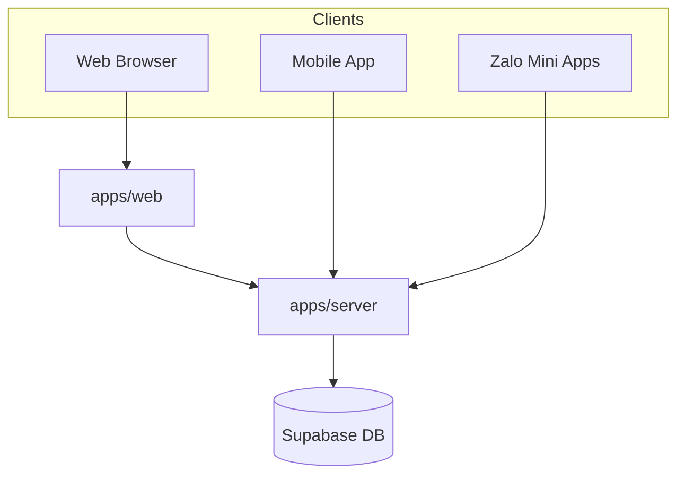
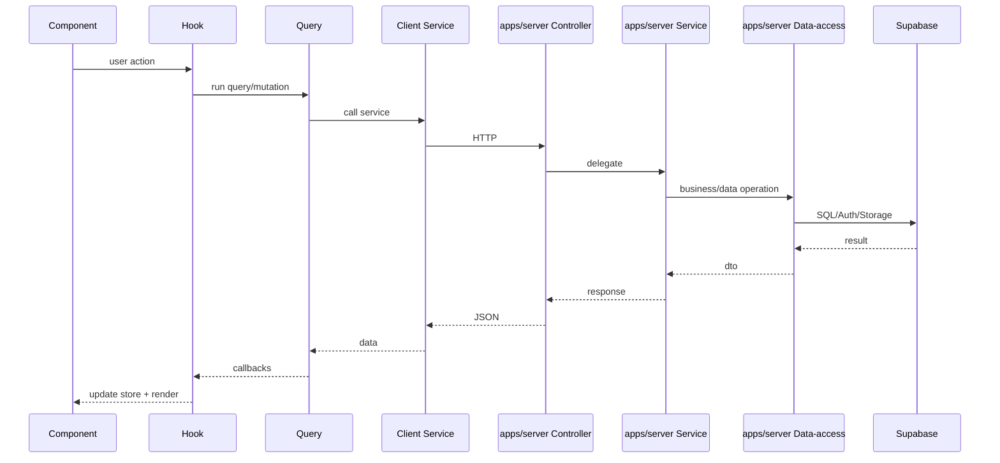

# 001 - Bức Tranh Hệ Thống (System Landscape)

## 1) Mục tiêu sản phẩm
Hệ thống phục vụ vận hành showroom cho thuê/bán sản phẩm thời trang và makeup, gồm:
- Quản trị nội bộ (admin/staff/manager/owner_admin).
- Kênh mobile cho cùng hệ sinh thái.
- Kênh Zalo Mini App cho luồng khách/public và tác vụ rút gọn.

## 2) Thành phần runtime chính

| Thành phần | Vai trò | Trạng thái |
|---|---|---|
| `apps/web` | Web app trung tâm: UI dashboard + compatibility API adapters tạm thời | Active |
| `apps/mobile` | Expo mobile app (voice/offline + API client) | Active |
| `apps/zalo-mini-apps/*` | 4 mini apps theo domain nghiệp vụ | Active |
| `apps/server` | NestJS backend source-of-truth + DB gateway duy nhất | Migration in-progress |
| Supabase | DB/Auth/RLS/Storage/Realtime (chỉ `apps/server` truy cập DB) | Data platform chính |

## 3) Domain nghiệp vụ chính
- Auth & Profile
- Branch / Settings / Showroom config
- Products / Inventory
- Customers / CRM
- Orders / Return Orders / Availability
- Payments / Reports / Dashboard
- Sales shift / POS
- Procurement
- Makeup module
- Notifications
- Voice transcription
- Zalo Mini App flows

## 4) Giao tiếp giữa các thành phần

Ghi chú:
- `apps/server` là backend source-of-truth.
- Chỉ `apps/server` được phép truy cập Supabase database.
- `apps/web` route layer còn lại chỉ dùng cho compatibility forwarding trong migration.

## 5) Luồng request nghiệp vụ chuẩn (web)

## 6) Các boundary kỹ thuật quan trọng
- Boundary 1: UI client vs server-only code
  - `apps/web/src/server/**` không được import vào client components.
- Boundary 2: Domain service vs data-access trong `apps/server`
  - business logic nằm ở `apps/server` service layer, data query nằm ở `apps/server` data-access/repository.
- Boundary 3: Supabase DB access ownership
  - chỉ `apps/server` được truy cập trực tiếp Supabase DB.
- Boundary 4: Web compatibility layer vs server source-of-truth
  - migration theo module, không big-bang.

## 7) Rủi ro kiến trúc đang tồn tại
- Một số luồng legacy còn đi qua web route layer trước khi chạm `apps/server`.
- Chưa hoàn tất decommission toàn bộ web business API cũ.
- Một số contract mini app còn mang dấu vết legacy (variant fields), cần đồng bộ dần theo schema mới.
