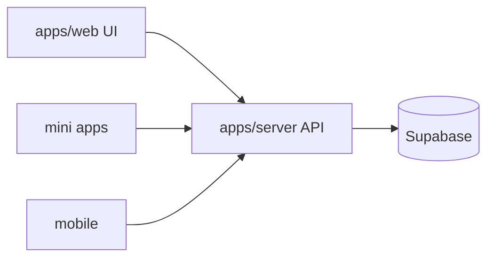

# 008 - Nest Server Target Architecture Và Migration Plan

## 1) Trạng thái hiện tại `apps/server`
- NestJS app đang ở mức scaffold:
  - `main.ts` listen `PORT` (default `3056`)
  - `AppModule` cơ bản
  - chưa có module nghiệp vụ migration từ web

## 1.1 Quy tắc ownership dữ liệu (đã chốt)
- Chỉ `apps/server` được phép truy cập Supabase database.
- `apps/web`, `apps/mobile`, `apps/zalo-mini-apps/*` phải gọi API qua `apps/server`.
- Legacy web routes còn lại chỉ được forward sang `apps/server`, không query DB trực tiếp.

## 2) Vì sao cần tách API khỏi web
- `apps/web` hiện đang là:
  - UI runtime
  - API route runtime
  - business + data-access runtime
- Hệ quả:
  - coupling cao
  - release blast radius lớn
  - khó scale backend độc lập.

## 3) Target architecture

Mục tiêu:
- Web giữ vai trò frontend + route pages.
- API business chuyển dần sang Nest controllers/services/modules.
- Caller (web client/mobile/mini-app) dùng base URL API chung.

## 4) Migration scope
- Inventory endpoint-by-endpoint từ `apps/web/src/app/api/**`.
- Port service logic từ `apps/web/src/server/services/**`.
- Port data-access contracts từ web sang Nest repository/data-access.
- Cập nhật caller services ở:
  - `apps/web/src/features/**/services/**`
  - `apps/zalo-mini-apps/**/src/**/services/**`
  - (khi cần) mobile service layer.
- Decommission trực tiếp `apps/web/src/server/data-access/**` sau khi domain cutover.

## 5) Migration principles
- Contract parity:
  - method/path/status/error payload tương thích trước.
- Không thay business rule trong cùng bước migration transport.
- Có compatibility window trước khi xóa route cũ.
- Decommission route cũ chỉ sau khi toàn bộ caller đã cutover.

## 6) Suggested module order
1. Runtime baseline (Nest main/config/validation/error envelope/healthcheck)
2. Auth + profile context
3. Settings + feature flags
4. Core domains (products/inventory/customers)
5. Orders/returns/payments/reports
6. Makeup/procurement/media
7. Zalo mini app endpoints
8. Caller cutover + route removal

## 7) Production endpoint policy
- API production domain đang được team quy ước: `https://kata-center-api.vercel.app`.
- Mọi caller cần dùng env-driven base URL, không hardcode trực tiếp trong component.

## 8) Success criteria
- [ ] Web API routes cũ không còn là source of truth.
- [ ] Caller apps dùng API base URL mới ổn định.
- [ ] Không còn truy cập Supabase DB từ runtime ngoài `apps/server`.
- [ ] Regression suite pass cho auth/rbac/domain critical flows.
- [ ] Observability + rollback plan có trước khi route removal.

## 9) Tài liệu task migration chi tiết
- [docs/tasks/modules/nest-server/001_nest_server_api_migration_foundation_and_consumer_cutover.md](../tasks/modules/nest-server/001_nest_server_api_migration_foundation_and_consumer_cutover.md)
- Chuỗi tasks `002` đến `013` trong cùng thư mục để theo dõi theo phase.

## 10) Quy tắc bắt buộc cho task migration mới
- Mọi task migration Nest mới phải tuân theo:
  - `docs/architecture/010_optimized_target_architecture.md`
  - `docs/architecture/011_task_architecture_compliance_standard.md`
  - `docs/architecture/012_apps_server_source_structure_for_cms_admin.md`
- Không chấp nhận task thiếu các section:
  - `Architecture Impact`
  - `Current State vs Target State`
  - `Boundary Rules`
  - `Compatibility & Migration Strategy`

## 11) Chuẩn cấu trúc source cho `apps/server`
- `apps/server` theo mô hình **modular monolith theo domain**.
- Mỗi module backend ưu tiên tách 4 lớp:
  - `presentation`
  - `application`
  - `domain`
  - `infrastructure`
- Data-access Supabase chỉ nằm trong `infrastructure`.
- Chi tiết chuẩn cấu trúc: `docs/architecture/012_apps_server_source_structure_for_cms_admin.md`.
