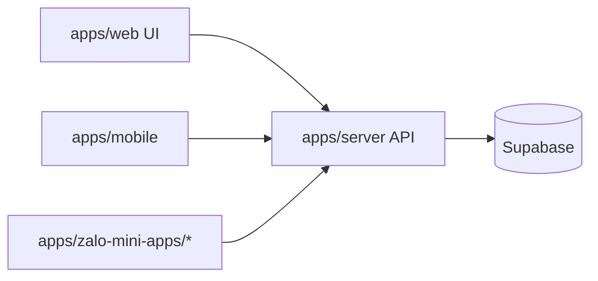

# 010 - Kiến Trúc Tối Ưu Mục Tiêu (Architecture V2)

## 1) Mục tiêu tối ưu
- Tách rời rõ frontend runtime và backend runtime để giảm coupling.
- Chuẩn hóa một API source-of-truth duy nhất cho mọi client.
- Tăng khả năng scale, release độc lập, observability và rollback an toàn.
- Giữ tương thích trong quá trình migration, tránh big-bang rewrite.

## 2) Hiện trạng vs mục tiêu

### 2.1 Hiện trạng (V1 - hybrid)
- `apps/web` đang vừa là:
  - UI app,
  - API route host (`app/api/**`),
  - business services + data-access.
- `apps/server` (Nest) mới scaffold.
- Zalo mini apps gọi web API base URL.

### 2.2 Mục tiêu (V2)
- `apps/server` (Nest) là backend source-of-truth.
- `apps/server` là runtime duy nhất truy cập Supabase DB.
- `apps/web` chỉ giữ:
  - UI pages/layouts,
  - middleware locale/cors,
  - compatibility adapters tạm thời (nếu cần).
- `apps/mobile` + `apps/zalo-mini-apps/*` gọi API Nest qua env base URL.

## 3) Topology kiến trúc mục tiêu


## 4) Nguyên tắc bắt buộc cho kiến trúc V2

### 4.1 API ownership
- Endpoint business mới **MUST** nằm trong `apps/server`.
- Supabase DB access **MUST** chỉ tồn tại trong `apps/server`.
- `apps/web/src/app/api/**` chỉ được dùng cho:
  - compatibility forwarding tạm thời,
  - integration đặc thù Next runtime (nếu chưa thể chuyển ngay).
- Không tạo endpoint business mới trực tiếp ở web route layer.

### 4.2 Backend layering (Nest)
```text
Controller -> Application Service -> Repository/Data-access -> Supabase
```
- Không để Controller truy cập DB trực tiếp.
- Không để repository chứa policy/flow nghiệp vụ phức tạp.

### 4.3 Client layering
```text
Component -> Hook -> Query -> Service -> API
```
- Component không gọi thẳng HTTP client.
- Query/mutation là nơi duy nhất gọi service network.

### 4.4 Contract-first
- DTO request/response/error contract phải ổn định trước khi cắt route cũ.
- Không đổi business semantics trong cùng PR migration transport.

## 5) Quy tắc migration bắt buộc
- Migrate theo domain slices, không migrate toàn bộ một lần.
- Mỗi endpoint migrate cần đủ 4 phần:
  1. Mapping cũ -> mới
  2. Contract parity
  3. Caller cutover
  4. Deprecation/rollback strategy
- Chỉ xóa route cũ khi:
  - tất cả caller đã cutover,
  - regression pass,
  - observability ổn định.

## 6) Kế hoạch tối ưu theo phase

### Phase A - Baseline
- Hoàn thiện Nest runtime baseline:
  - validation
  - error envelope
  - config/cors
  - health/readiness

### Phase B - Core domains
- Auth/session/settings flags
- Products/inventory/customers
- Orders/returns/payments/reports

### Phase C - Channels
- Zalo mini app APIs
- Mobile critical APIs (nếu cần qua Nest)

### Phase D - Decommission
- Remove web business routes
- Cleanup web `server/services` và `server/data-access` legacy

## 7) Chỉ số hoàn thành kiến trúc V2
- [ ] 100% business endpoints source-of-truth tại Nest
- [ ] 100% callers dùng Nest base URL
- [ ] `apps/web/app/api` không còn business domain endpoint
- [ ] Regression suite pass cho auth/rbac/order/payment/report/mini-app
- [ ] Observability dashboard có p95/error budget cho domain critical

## 8) Anti-pattern cấm trong kiến trúc mới
- Tạo endpoint mới ở `apps/web/app/api` cho domain đã migrate.
- Duplicate business logic ở cả web và server.
- Caller mix ngẫu nhiên giữa web API cũ và Nest API mới trong cùng domain.
- Thêm feature mới dựa trên legacy route cũ khi đã có endpoint Nest tương đương.
- Query Supabase DB trực tiếp từ `apps/web`, `apps/mobile`, `apps/zalo-mini-apps/*`.

## 9) Hướng mở rộng sau V2
- Sau khi hoàn thành V2 ổn định (source-of-truth tập trung ở `apps/server`),
  hướng mở rộng next-level theo microservices/event-driven/Kafka được mô tả tại:
  - `docs/architecture/013_next_level_microservices_event_driven_kafka.md`
- Lưu ý:
  - `013` là blueprint cho phase scale tiếp theo.
  - Không thay đổi ngay boundary hiện tại trong V2.
