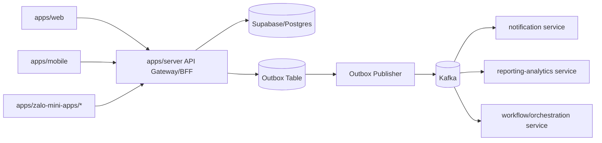

# 013 - Next Level: Microservices + Event-Driven + Kafka (Blueprint)

## 1) Mục tiêu tài liệu
- Định nghĩa kiến trúc mục tiêu cấp tiếp theo cho giai đoạn scale lớn.
- Giữ nhất quán với constitution hiện tại:
  - `apps/server` vẫn là source-of-truth runtime trong current phase.
  - Không chuyển ngay sang microservices theo kiểu big-bang.
- Cung cấp lộ trình từng phase để nâng cấp an toàn.

## 2) Current state (đã triển khai)
- Runtime backend chính: `apps/server` (NestJS modular monolith theo domain).
- DB gateway duy nhất: `apps/server` -> Supabase.
- Domain modules đang có trong source:
  - `auth`, `customers`, `health`, `inventory`, `makeup`, `media`, `mini-app`,
    `orders`, `payments`, `procurement`, `products`, `reports`, `returns`, `settings`.
- Event hiện có ở mức dữ liệu/domain:
  - `audit_events` cho tracking nghiệp vụ.
  - `zalo_mini_app_webhook_events` cho webhook idempotency/retry visibility.
- Chưa có:
  - Kafka broker.
  - Outbox/Inbox pattern chuẩn hóa.
  - Async event contracts liên service.

## 3) Target state (next-level)
- Kiến trúc mục tiêu: **modular monolith + event backbone**, sau đó tách dần sang microservices.
- Event transport chuẩn: **Kafka**.
- Giao tiếp hệ thống theo 2 đường:
  - Sync API (REST) cho read/write cần response tức thời.
  - Async events (Kafka) cho side effects, integration, analytics, workflows.

## 4) Nguyên tắc kiến trúc bắt buộc
- Không tách service nếu chưa có bottleneck rõ về scale, ownership, release cadence.
- Tách theo bounded context/domain, không tách theo technical layer.
- Mọi event phát hành phải:
  - có version (`eventVersion`),
  - có idempotency key (`eventId`),
  - có timestamp và producer metadata,
  - có schema contract được kiểm soát.
- Event-driven không thay thế hoàn toàn transaction consistency:
  - ghi dữ liệu nghiệp vụ + outbox trong cùng transaction boundary.

## 5) Candidate bounded contexts
- `identity-access` (auth/session/rbac)
- `catalog-inventory` (products/categories/inventory/procurement)
- `orders-returns-payments` (order lifecycle, return lifecycle, payment ledger)
- `makeup-booking` (events/packages/artist availability)
- `channel-miniapp` (zalo session/payment/webhook/voice adapter)
- `reporting-analytics` (aggregation, dashboards, exports, near-real-time projections)
- `notification` (OA/push/email/sms, retry/dead-letter)
- `media` (upload/completion/quota/asset metadata)

## 6) Event taxonomy (đề xuất)
- Domain events:
  - `orders.order_created.v1`
  - `orders.order_status_changed.v1`
  - `payments.payment_posted.v1`
  - `inventory.item_status_changed.v1`
  - `makeup.booking_created.v1`
  - `miniapp.webhook_received.v1`
- Integration events:
  - `notification.dispatch_requested.v1`
  - `analytics.fact_order_upserted.v1`
  - `risk.payment_reconciliation_requested.v1`

## 7) Kafka topic strategy (đề xuất)
- Naming:
  - `<domain>.<event_name>.v<version>`
  - ví dụ: `orders.order_created.v1`
- Partition key:
  - theo aggregate root id (`orderId`, `paymentId`, `profileId`).
- Retention:
  - domain topic: retention vừa đủ cho replay ngắn hạn.
  - audit/analytics topic: retention dài hơn theo nhu cầu BI.
- Delivery:
  - consumer bắt buộc idempotent.
  - at-least-once là baseline; exactly-once chỉ áp dụng nơi bắt buộc.

## 8) Outbox/Inbox pattern (đề xuất bắt buộc khi bật Kafka)
- Outbox table trong domain DB:
  - `event_id`, `aggregate_type`, `aggregate_id`, `event_name`, `event_version`, `payload_json`, `occurred_at`, `published_at`, `publish_attempt`.
- Publisher worker:
  - poll outbox theo batch,
  - publish Kafka,
  - mark `published_at`.
- Inbox table tại consumer:
  - lưu `event_id` đã xử lý để chống duplicate.

## 9) Migration roadmap (không big-bang)
- Phase 0: Harden monolith
  - Chuẩn hóa domain events nội bộ ở `apps/server`.
  - Chuẩn hóa audit + idempotency + request correlation.
- Phase 1: Introduce Kafka backbone
  - Bật outbox publisher từ `apps/server`.
  - Tạo consumer cho `notification` và `analytics` trước.
- Phase 2: Sidecar services
  - Tách `notification` và `reporting-analytics` ra service độc lập.
- Phase 3: Core domain split (nếu cần)
  - Cân nhắc tách `orders-returns-payments` khi traffic/ownership đủ lớn.
- Phase 4: Platform hardening
  - DLQ, replay tooling, schema registry, SLO/SLA theo topic.

## 10) Security và governance cho event-driven
- Không publish secrets/PII nhạy cảm dạng raw vào payload event.
- Payload phải được classify:
  - public/internal/restricted.
- Bắt buộc trace correlation:
  - `requestId`, `traceId`, `actorId`, `sourceApp`.
- ACL topic theo producer/consumer service account.

## 11) Observability cho Kafka architecture
- Metrics tối thiểu:
  - publish success/error rate,
  - consumer lag,
  - retry count,
  - DLQ count.
- Logging:
  - structured logs theo `eventId`, `topic`, `partition`, `offset`.
- Alerting:
  - lag vượt ngưỡng,
  - DLQ tăng đột biến,
  - publish failure liên tục.

## 12) Non-goals ở phase hiện tại
- Không thay đổi ngay ownership hiện tại:
  - `apps/server` vẫn là API source-of-truth.
- Không phá vỡ contract sync API hiện có với web/mobile/mini-app.
- Không tách microservices khi chưa có runbook, CI/CD, observability readiness.

## 13) Sơ đồ target blueprint

## 14) Điều kiện để bắt đầu Phase 1
- Có bộ event contract tối thiểu cho domain chính.
- Có runbook vận hành Kafka (deploy, scaling, backup, incident).
- Có test chiến lược:
  - contract test producer/consumer,
  - idempotency test,
  - replay test.
- Có dashboard quan sát lag/retry/DLQ trước khi go-live.
