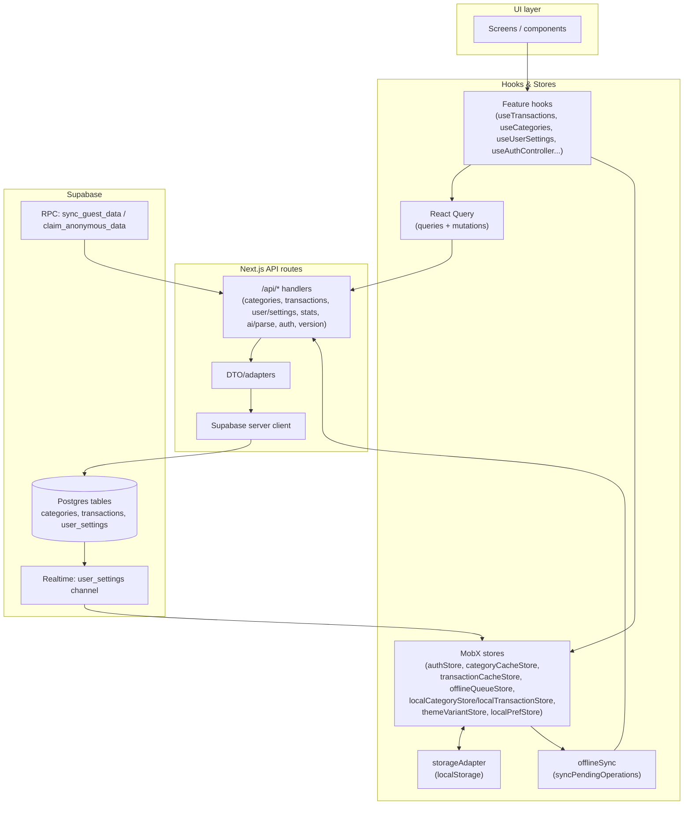

# Web Data Flow (Current)

## Flowchart

## Layering (MCP rules)
- Components render only; no direct storage/service calls.
- Hooks own business logic and call React Query.
- React Query is the sole server-state orchestration; services live behind queries.
- MobX stores hold client state + persistence (auth, caches, offline queue, local/anonymous data, theme).
- `storageAdapter` is used by stores/caches only (never directly in components).

## Auth & onboarding flow (store-driven)
- `useAuthController` drives auth and mirrors state into `authStore` (`user`, `isAnonymous`, `loading`, `userSettings`).
- `AuthGate` observes `authStore`; shows loading until auth + settings ready. If `authStore.userSettings.currency` exists, routes to `/home` (skips onboarding).
- Settings: `useUserSettings` updates `authStore` optimistically. Offline writes are queued; anonymous writes stay local.
- Theme/language/pro mode sync: `UserSettingsSync` mirrors preferences to Supabase when logged in; otherwise persists locally.

## Categories & transactions
- Online mode: React Query mutations call services → API → Supabase; results update cache stores (`categoryCacheStore`, `transactionCacheStore`) which persist via `offlineCache` to localStorage.
- Offline mode: mutations create optimistic records, enqueue into `offlineQueueStore`, and write to cache stores; `useOfflineSync` replays when back online.
- Anonymous mode: uses `localCategoryStore`/`localTransactionStore`; data stays in localStorage until user logs in. RPC (`sync_guest_data`) can push guest data; `claim_anonymous_data` merges on upgrade.
- Account switch: if a new login differs from the cached email and local data exists, `AccountSwitchPrompt` asks the user; on confirm we back up local data (`insertUserBackup`), clear local caches, and load server data for the new account.

## Data persistence & sources of truth
- MobX stores are the in-app source of truth; UI reads stores directly (observer).
- Cache stores persist per-user data to localStorage; offline queue persists pending ops.
- `authStore.fetchSettings` + Supabase Realtime keep `user_settings` fresh; cached settings are used while offline.
- Theme palette also sets CSS vars (`data-theme`) and `--tabbar-bg` for bottom navigation.

## Anonymous ↔ authenticated sync
1) While anonymous: data lives only in local stores. Settings live in offline settings storage.
2) On login with existing local data: user chooses via prompt:
   - Erase & switch: local data is backed up (hidden) then cleared; server data becomes active.
   - (Sync path currently disabled to avoid mixing states.)
3) RPC helpers (`sync_guest_data`, `claim_anonymous_data`) are available for future merge flows.

## Key stores
- `authStore`: session, isAnonymous, userSettings, loading, realtime subscription.
- `transactionCacheStore` / `categoryCacheStore`: cached server data + offline persistence.
- `offlineQueueStore`: pending mutations for replay.
- `localTransactionStore` / `localCategoryStore`: guest data.
- `themeVariantStore`, `localPrefStore`: local UI prefs/onboarding flags.

## Backend surfaces
- API routes: `/api/transactions`, `/api/categories`, `/api/user/settings`, `/api/stats/summary`, `/api/ai/parse`, `/api/auth/*`, `/api/force-reset`, `/app/version`.
- Supabase: tables `transactions`, `categories`, `user_settings`; realtime on `user_settings`; RPC for guest sync/claim.***
