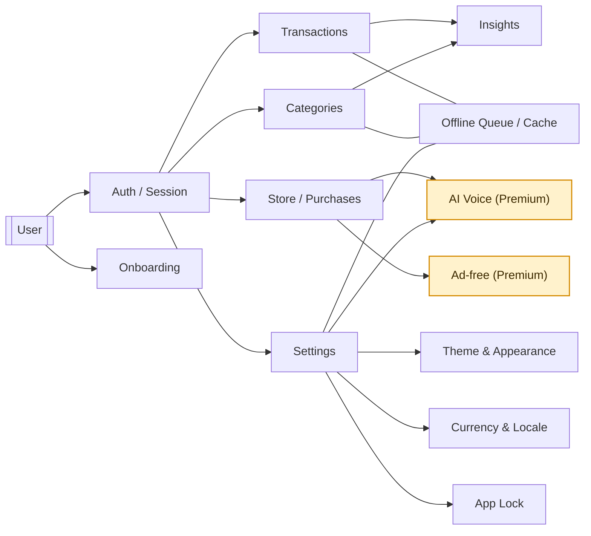

## Feature map (Mermaid)

## Web app feature guide

### Overview
- Next.js App Router client with MobX stores for local state, React Query for network/cache, and Supabase (Postgres + Realtime) for backend data.
- All persistence flows through stores + storageAdapter (no direct localStorage). Offline queue preserves mutations and syncs when connectivity returns.
- Primary domains: authentication/onboarding, transactions, categories, settings (theme, currency, language, app lock), and AI voice preferences.
- Premium markers: ad-free experience and AI voice; unlocked via store purchases (subscription or one-time, per platform support).

### Access & identity
- Email-based authentication via Supabase; session persisted through auth store + storageAdapter.
- Deep link callback flow handled in auth routes to complete sign-in and refresh tokens.
- Anonymous mode: Supabase anonymous user when env is configured; otherwise local-only guest. Local data (transactions/categories/settings) stays on-device and is merged to the real account on login via `syncAnonymousData()`. Currency cannot be changed once set; on production, bearer token is sent so `/api/user/settings` can resolve the anonymous session.

### Data & sync model
- React Query drives all fetch/mutate calls; results hydrate MobX stores for UI consumption and offline usage.
- Supabase Realtime subscriptions push server changes back into stores to keep multiple sessions consistent.
- Offline: mutations enqueue to `offlineQueueStore` (transactions, categories, settings). `useOfflineSync` auto-replays when back online (with bearer token if available). Reads fall back to cache stores and `useUserSettings` uses cached settings to avoid onboarding loops while offline.

### Money features
- Transactions: create/update/delete, with optimistic updates and cached copies in `transactionCacheStore`; merge reconciliation runs post-fetch.
- Categories: create/update/delete with `categoryCacheStore` and placeholder rendering while awaiting server confirmation.
- Basic analytics surfaced from cached totals (spend by category, recent activity) when available; server data overrides once fetched.

### Store / purchases
- In-app store entry points for one-time products and subscriptions (IAP); tracks entitlement in user settings.
- Purchase state gates premium features (ad-free, AI voice); entitlement cached locally for offline UX and revalidated on sync.
- Trial/consumable tracking supported via aiTrial flags and aiRequestsRemaining in user settings.
- Offline limits: Store UI disables purchase buttons and AI trial when offline; AI Assistant modal shows offline banner.

### Settings & personalization
- Theme variant: light/dark/system stored in `themeVariantStore` and synced to user settings.
- Currency preference persisted in user settings; drives formatting in UI utilities.
- Language/locale flag stored alongside preferences (local-first, synced when online).
- App lock setting (PIN/biometric flag) stored in user security settings; enforced by the UI guard when enabled.
- Onboarding checklist tracks completion state in local prefs to reduce server chatter.
- Offline settings: `useUserSettings` writes to cache and enqueues PATCH when offline; onboarding PATCH is queued but cached currency avoids redirect loops. Currency remains immutable after first set.

### AI voice
- User voice engine/provider, gender, tone, and speaking rate configurable in AI voice settings store.
- Premium feature: requires active purchase/entitlement; trial tracking via aiTrial flags and aiRequestsRemaining in user settings.
- Voice actions reuse the same queue/caching mechanics for resilience; settings are persisted locally and synced to cloud.
- Offline limits: AI mode disabled when offline; AI settings toggle is disabled and warns; parser falls back to non-AI path without consuming requests.

### Error handling & resilience
- Mutations: queued when offline; retries with exponential backoff; server responses are the source of truth for final state.
- Reads: placeholder data rendered from cache; UI reconciles once network responses arrive; realtime events eventually converge.
- Consistency guards: avoid double-patching—always apply server payloads to stores after optimistic writes.
- Production auth nuance: when cookies aren’t sent (e.g., anonymous session), client attaches bearer token and server creates a token-bound Supabase client so settings fetch/PATCH returns the correct user.

### Security & privacy
- Supabase Row-Level Security protects per-user data; client only sends user-scoped queries.
- Sensitive local data (session, app lock flags) stored through storageAdapter to allow platform-specific hardening.
- Minimal PII retained: email for auth; financial data scoped to the authenticated user.

### Related docs
- Data flow: docs/technicalDocs/web/data-flow.md
- AI voice implementation: docs/AI_VOICE_SETTINGS_IMPLEMENTATION.md
- Auth deep link: docs/000_auth-deeplink.md
